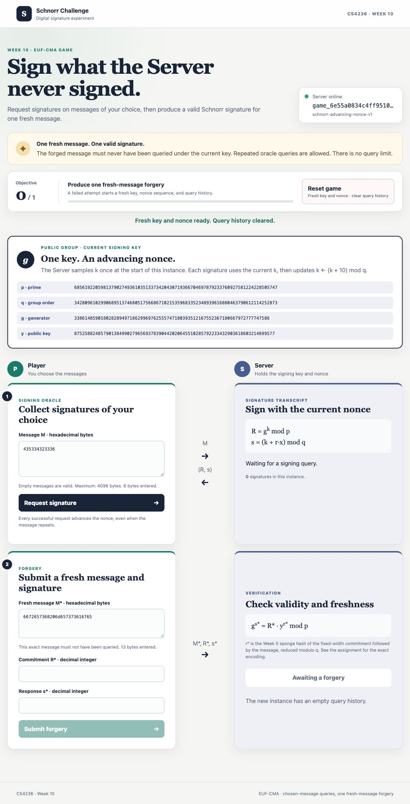

# EUF-CMA Game — Schnorr Signatures

## Page preview

The Server holds a secret signing exponent and answers signature requests.
Produce a valid signature for one fresh message to reveal its startup secret.
Here, **fresh** means that the message's exact bytes have never been submitted
to the signing oracle in the current instance.

## Cryptographic construction

The suite is `schnorr-advancing-nonce-v1`. At service startup, the Server calls
Week 8's `educrypto.dh.generate_parameters(bits=256)` once. This produces
`p = 2*q + 1` with prime `p` and `q`, and a generator `g` of order `q`.
The public group is shared by games and remains unchanged on reset.

Each new instance samples a private exponent `x` uniformly from `1..q-1`,
publishes `y = pow(g, x, p)`, and samples one nonce `k` uniformly from `0..q-1`.
For each message `M`, the signing oracle computes:

~~~text
R = pow(g, k, p)
L = (p.bit_length() + 7) // 8
digest = sponge_hash(R.to_bytes(L, "big") + M,
                     c=8, digest_length=32, rounds=20)
r = int.from_bytes(digest, "big") % q
s = (k + r*x) % q
k = (k + 10) % q
~~~

It returns `(R, s)`. The first signature uses the initial nonce; subsequent
requests use the updated nonce, including when a message repeats.

The sponge uses its default S-box. The oracle signs directly rather than
calling your `sign` function; forgery checking calls your `verify` function.
The private exponent and nonce remain secret.

## Rules and state changes

- One valid signature on a fresh message wins immediately.
- Messages may contain 0 through 4096 bytes. There is no query limit or required
  number of queries. Repeated messages are allowed and count as separate requests.
- Freshness compares decoded bytes; hex case and whitespace do not create
  different messages.
- A well-formed invalid signature or a non-fresh message fails the attempt.
  The Server immediately samples another key and initial nonce and clears
  the query history and count. The game ID and public group remain unchanged.
- **Reset game** performs the same refresh and can restart a completed game.
- Malformed requests leave state unchanged. After victory, signing and forgery
  requests return `409` until reset. Only a successful forgery returns the secret.

## Browser workflow

1. Open the page. It automatically creates a game and displays `p`, `q`, `g`,
   and the current public key `y`.
2. Enter a message as hexadecimal bytes and select **Request signature**.
   The transcript records the message and decimal `R` and `s`. Repeat as needed.
3. Analyze the responses, then enter a fresh hexadecimal message and proposed
   decimal `R` and `s` in the forgery panel. Select **Submit forgery**.
4. Read the result panel. On failure, the page updates the public key and clears
   the old transcript and signature inputs.

Reset clears the transcript, signature inputs, previous result, and victory
panel. Message inputs are kept for convenience.

## Setup

Complete the Week 5 hash, Week 8 DH, and Week 10 signature API first. Install
your library in editable mode, then install Flask in that same environment.

### macOS and Linux

From the course-material repository root:

~~~bash
python3 -m pip install -r course/week10/challenge/requirements.txt
cd course/week10/challenge
SECRET='replace-me' python3 server.py
~~~

### Windows PowerShell

From the course-material repository root:

~~~powershell
py -m pip install -r course/week10/challenge/requirements.txt
Set-Location course/week10/challenge
$env:SECRET = 'replace-me'
py server.py
~~~

Open `http://127.0.0.1:8000`. `SECRET` must be set to a nonempty string. The
server also accepts `--host` and `--port`; startup includes group generation.

## Student attack entry point

Create `src/educrypto/attacks/week10.py` in your library:

~~~python
def solve(base_url: str) -> str:
    ...
~~~

Use `base_url` to create a game and submit a successful fresh-message forgery.
Return the exact secret from that response. Do not assume a fixed hostname or
port, start a Server, or access its environment or private state.

## HTTP API

Bodies are JSON objects. `message_hex` is decoded with Python's `bytes.fromhex`;
it may be empty, and ASCII whitespace may separate complete bytes. Cryptographic
integers (`p`, `q`, `g`, `y`, `R`, `s`) use **decimal strings** containing only
digits; leading zeros are accepted. Counts are ordinary JSON integers.

### Health and game creation

`GET /health` returns `200 OK`:

~~~json
{"status": "ok", "service": "schnorr-euf-cma-game"}
~~~

`POST /api/v1/games` needs no request body and returns `201 Created`:

~~~json
{
  "game_id": "game_...",
  "suite": "schnorr-advancing-nonce-v1",
  "p": "...",
  "q": "...",
  "g": "...",
  "y": "...",
  "queries": 0,
  "wins": 0,
  "wins_required": 1,
  "complete": false
}
~~~

Save `game_id` for the remaining operations. Ellipses represent returned values.

### Reset

`POST /api/v1/games/{game_id}/reset` needs no body and returns `200 OK` with
the same game-view shape as creation. It contains the newly sampled public
key, zero queries and wins, and `complete: false`. Reset also works after a win.

### Signing oracle

`POST /api/v1/games/{game_id}/oracle` accepts:

~~~json
{"message_hex": "435334323336"}
~~~

It returns `200 OK` with the signature and cumulative request count:

~~~json
{"R": "...", "s": "...", "queries": 1}
~~~

### Submit a forgery

`POST /api/v1/games/{game_id}/forge` accepts:

~~~json
{"message_hex": "6672657368", "R": "90", "s": "83"}
~~~

The sample values illustrate the format, not a valid signature for your game.
A well-formed attempt returns `200 OK`:

~~~json
{
  "valid": true,
  "fresh": true,
  "game": {
    "game_id": "game_...",
    "suite": "schnorr-advancing-nonce-v1",
    "p": "...",
    "q": "...",
    "g": "...",
    "y": "...",
    "queries": 2,
    "wins": 1,
    "wins_required": 1,
    "complete": true
  },
  "secret": "the exact startup secret"
}
~~~

`valid` means that the message was fresh **and** the signature verified.
`fresh` reports whether the exact message had been queried. On failure,
`valid` is `false`, `secret` is omitted, and `game` is the already-refreshed
instance: its new public key, zero queries and wins, and `complete: false`.
Always use that returned game view after an attempt.

Syntactically valid decimal fields outside the signature's mathematical
ranges (for example, `R: "0"` or `s >= q`) are failed forgery attempts, not
parsing errors, and therefore start a fresh instance.

### Errors

Errors return `{"error": "human-readable explanation"}` with these statuses:

| Status | Meaning |
| --- | --- |
| `400` | Invalid JSON/object, missing fields, malformed hex/decimal strings, integers too large to parse, or a message over 4096 bytes |
| `404` | Unknown route or game ID |
| `405` | Wrong HTTP method |
| `409` | Signing or forgery on a completed game; reset first |
| `413` | HTTP request body larger than 1,000,000 bytes |
