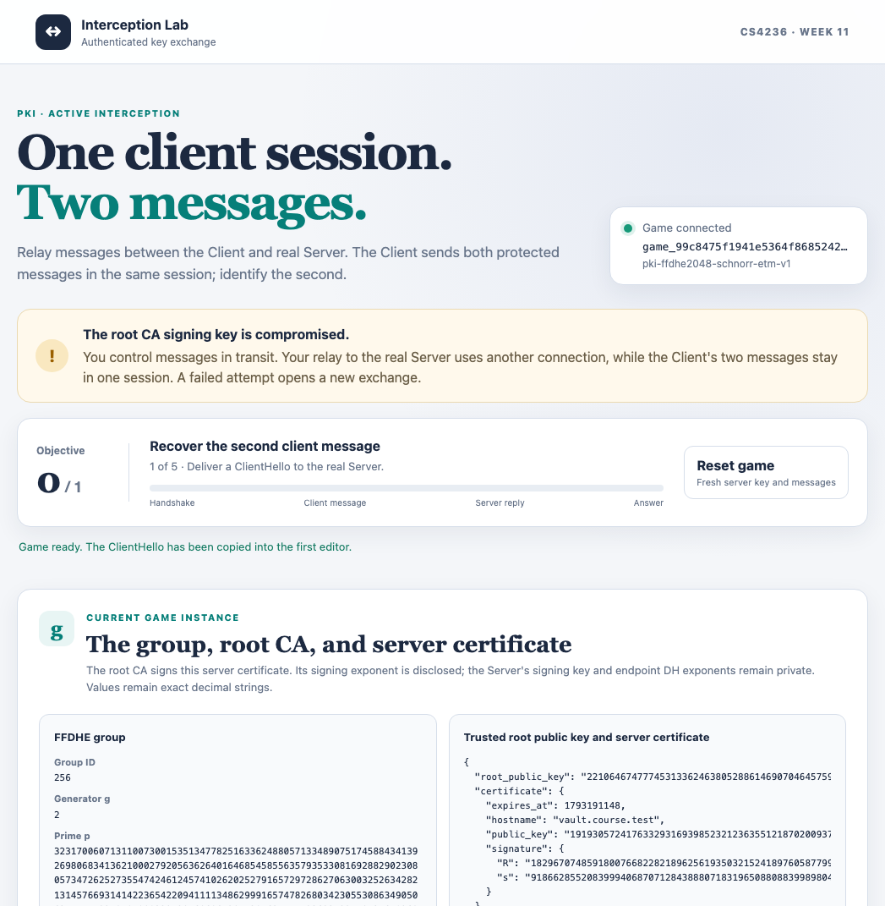

# Interception Lab — PKI relay game

## Page preview

The Client intends to connect to `vault.course.test`.

You control the messages delivered between the Client and real Server. The trusted root
CA's **signing private key is disclosed to you**.

Learn the second application message sent by the client in the same session as its first message. One correct plaintext submission reveals the exact startup secret.

We fix a group The group uses FFDHE2048, you can find it in `pki_helpers.py`

- KEM: DHKE with FFDHE2048
- Digital Signature: Schnorr with FFDHE2048
- Symmetric Key: ETM from week06 (round = 20)

## Construction and game rules

This game runs one Client and one real Server. The Client sends its two application records in one session, with send sequence numbers 0 and 1. The Player's connection to the real Server is
a separate relay session. The five exchanges occur in order:

1. A fresh ClientHello is shown. Deliver a ClientHello of your choice to
   the real Server and receive its server response.
2. Deliver a server response of your choice to the Client. If accepted,
   the Client sends its first encrypted application record.
3. Deliver a record to the real Server. If it decrypts, the Server responds
   using the plaintext it received.
4. Deliver a record to the Client. If it decrypts, the Client generates
   a fresh nonce and sends its second encrypted application record using
   the plaintext it received.
5. Submit the exact second Client plaintext as hexadecimal bytes.

Define `H(data) = sponge_hash(data, c=8, digest_length=32, rounds=20)`.
The application plaintexts have fixed forms:

~~~text
First Message (Client to Server):
C1 = 32 fresh random bytes from the Client

First Response (Server to Client):
S1 = H(C1 || server_nonce)

Second Message (Client to Server):
C2 = H(S1 || client_new_nonce)
~~~

Each side uses the plaintext it decrypts from the relayed record, even if
the Player changed it.

Both `S1` and `C2` are 32 bytes. Each nonce is 32 fresh bytes.
The Client samples `client_new_nonce` only after it accepts the relayed
Server record. The final guess must contain all 32 bytes of `C2`. The
first message or a value calculated before the Client sends `C2` is not
the final answer.

One correct final guess wins.

## Browser workflow

Opening the page automatically creates a game. The upper card shows the
public group, trusted root public key, server certificate, and
intentionally disclosed root CA signing exponent. The numbered cards
show the intercepted ClientHello and later public protocol messages.
Enter a JSON message or record in the active Player card, then use its
action button to deliver it. Successful responses are copied into the
next editor so you can inspect and change them before delivery.

The page never displays the hidden application plaintexts, the real
Server's signing exponent, or endpoint ephemeral DH exponents. The
progress card shows the current stage. Reset clears the local transcript
and opens a fresh attempt. DH public keys and signatures remain decimal
strings in the browser; do not convert them to JavaScript `Number` values.

## Setup

Complete Weeks 5, 6, 8, and 10, then implement `educrypto.pki` in your own
repository. Copy only `course/week11/pki_helpers.py` to
`src/educrypto/pki_helpers.py`. The challenge server's protocol code stays
in this folder and is not copied into your library. Install your library
in editable mode. The challenge requires Flask.

### macOS and Linux

From your library repository:

~~~bash
python3 -m pip install -e '.[test]'
~~~

From the course-material repository:

~~~bash
python3 -m pip install -r course/week11/challenge/requirements.txt
cd course/week11/challenge
SECRET='replace-me' python3 server.py
~~~

### Windows PowerShell

From your library repository:

~~~powershell
py -m pip install -e '.[test]'
~~~

From the course-material repository:

~~~powershell
py -m pip install -r course/week11/challenge/requirements.txt
Set-Location course/week11/challenge
$env:SECRET = 'replace-me'
py server.py
~~~

Open `http://127.0.0.1:8000`. `SECRET` must be a nonempty string. The
server also accepts `--host` and `--port`. Use a fresh local process for
each run.

## Student attack entry point

Create `src/educrypto/attacks/week11.py`:

~~~python
def solve(base_url: str) -> str:
    ...
~~~

Use the supplied URL to create a game, complete the
handshake legs with the Client and real Server, then relay their
application records. Return the startup secret from the successful guess
response. Do not start your own Server, read its process environment or
private state, assume a fixed port, or guess the secret.

## HTTP API

All requests and responses use JSON objects. The shapes for ClientHello,
ServerResponse, Certificate, and Record are shown below. The challenge
application accepts these same dictionaries directly.
- Cryptographic integers and record sequence numbers are
  decimal strings.
- Byte strings are lowercase hexadecimal on output
- Certificate expiry, small counts, and group identifiers are ordinary JSON integers.
- All action bodies include the current `attempt_id`.

`GET /health` returns `200` with:

~~~json
{"status": "ok", "service": "pki-relay-game"}
~~~

`POST /api/v1/games` needs no body. You may send the empty JSON object
`{}`; the route ignores it. It returns `201` with a game view:

~~~json
{
  "game_id": "game_...",
  "attempt_id": "attempt_...",
  "stage": "server_hello",
  "suite": "pki-ffdhe2048-schnorr-etm-v1",
  "group": {"id": 256, "p": "...", "q": "...", "g": "2"},
  "client_hello": {"server_name": "vault.course.test", "key_share": "..."},
  "root_public_key": "...",
  "certificate": {
    "hostname": "vault.course.test",
    "public_key": "...",
    "expires_at": 2000000060,
    "signature": {"R": "...", "s": "..."}
  },
  "compromised_root_signing_private_key": "...",
  "wins": 0,
  "wins_required": 1,
  "complete": false
}
~~~

The ellipses and expiry time illustrate the shape; actual responses contain
the current values. `compromised_root_signing_private_key` is the root
CA's signing exponent as a decimal string; it remains the same across
attempts in one game. Save both IDs. The `attempt_id` changes whenever an
attempt resets; `game_id` does not. The six stages are `server_hello`,
`client_accept`, `relay_to_server`, `relay_to_client`, `guess`, and
`complete`.

### Exchanges

Replace `{game_id}` in every URL with the `game_id` from the current game
view. Send a JSON object with the current `attempt_id` at each step. The
examples below are valid JSON showing the **fields and types**, but their
short decimal and hex values are illustrative, not usable cryptographic
messages. Use live values from the game and exchange responses. Every
request object, including each nested object, must have exactly the
shown fields.

Each accepted exchange returns `200` with `accepted: true`, a complete
updated `game` view, and the message named for that step. Read
`game.stage` to see the next step. The returned message is a separate
top-level field, not a field inside `game`.

#### 1. Client to Server: deliver a ClientHello

`POST /api/v1/games/{game_id}/server-hello` takes the intercepted
`client_hello` from the game view, or another ClientHello you construct:

~~~json
{
  "attempt_id": "attempt_0123456789abcdef0123456789abcdef",
  "client_hello": {
    "server_name": "vault.course.test",
    "key_share": "123456789"
  }
}
~~~

`server_name` is a string and `key_share` is a decimal string. An
accepted request returns `server_response` and a game view at
`client_accept`. The response object contains the Server's ephemeral
`key_share`, its `certificate`, and a handshake `signature`, with the
same structure shown in the next request.

#### 2. Server to Client: deliver a server response

`POST /api/v1/games/{game_id}/client-accept` takes the
`server_response` from step 1, or another ServerResponse you construct:

~~~json
{
  "attempt_id": "attempt_0123456789abcdef0123456789abcdef",
  "server_response": {
    "key_share": "234567891",
    "certificate": {
      "hostname": "vault.course.test",
      "public_key": "345678912",
      "expires_at": 2000000060,
      "signature": {"R": "456789123", "s": "567891234"}
    },
    "signature": {"R": "678912345", "s": "789123456"}
  }
}
~~~

`key_share`, `certificate.public_key`, and both signatures' `R` and
`s` are decimal strings. `certificate.hostname` is a string and
`certificate.expires_at` is a JSON integer.

The Client verifies the
certificate using the trusted root public key, requested hostname, and
current time. `certificate.signature` covers
`encode_certificate_fields(hostname, public_key, expires_at)` directly.

The Client then verifies `server_response.signature` using
`certificate.public_key` over
`server_response["key_share"].encode("utf-8")`.

Either failed check
rejects the response. An accepted request returns a `record` carrying
the Client's first application message and a game view at
`relay_to_server`.

For each connection, derive the DH shared value with
`shared = dh.derive_shared_key(own_private_key, peer_public_key)`, then
`key = dh.derive_shared_key_bytes(shared, length=48)`. Use this ETM key
in both directions.

#### 3. Client to Server: relay the first record

`POST /api/v1/games/{game_id}/relay-to-server` takes the first Client
`record` from step 2, or another Record you construct:

~~~json
{
  "attempt_id": "attempt_0123456789abcdef0123456789abcdef",
  "record": {
    "direction": "0",
    "sequence": "0",
    "iv_hex": "0123456789abcdef",
    "ciphertext_hex": "a1b2",
    "tag_hex": "00112233445566778899aabbccddeeff"
  }
}
~~~

`direction` and `sequence` are decimal strings: `"0"` means
Client-to-Server and `"1"` means Server-to-Client. `iv_hex`,
`ciphertext_hex`, and `tag_hex` are separate hex strings representing
bytes. Each record gets a fresh random 8-byte IV in `iv_hex`;
`ciphertext_hex` contains only ciphertext.
The Client's first sent record has direction `"0"` and sequence `"0"`.
An accepted request returns a `record` with direction `"1"` containing the
Server's encrypted response and a game view at `relay_to_client`.

The direction and sequence number are included in the authenticated data:

~~~python
iv = bytes.fromhex(record["iv_hex"])
associated_data = record["direction"].encode() + record["sequence"].encode()
~~~

The receiver rejects a record whose direction is wrong for that exchange
or whose sequence is not the next expected number.
Pass both values to Week 6 `encrypt_etm` or `decrypt_etm` with
`rounds=20`.

#### 4. Server to Client: relay the response record

`POST /api/v1/games/{game_id}/relay-to-client` takes the Server
`record` from step 3, or another Record you construct:

~~~json
{
  "attempt_id": "attempt_0123456789abcdef0123456789abcdef",
  "record": {
    "direction": "1",
    "sequence": "0",
    "iv_hex": "fedcba9876543210",
    "ciphertext_hex": "c3d4",
    "tag_hex": "ffeeddccbbaa99887766554433221100"
  }
}
~~~

The Record fields and types are identical to step 3. The Server's
first sent record has direction `"1"` and sequence `"0"`. An accepted
request returns a `record` with direction `"0"` containing the Client's second
encrypted message, with sequence `"1"`, and a game view at `guess`.

#### 5. Final answer: submit the second Client plaintext

`POST /api/v1/games/{game_id}/guess` takes the complete second Client
plaintext as hexadecimal bytes in `message_hex`:

~~~json
{
  "attempt_id": "attempt_0123456789abcdef0123456789abcdef",
  "message_hex": "00112233"
}
~~~

The short hex string only illustrates the field type. The correct
answer is exactly 32 bytes, or 64 hex digits. The response contains
`correct` (a JSON boolean) and a complete `game` view. A correct guess
returns `correct: true`, `game.stage: "complete"`, and a top-level
`secret` string. A wrong guess returns `correct: false` and a fresh
game view at `server_hello`, without `secret`. The input may contain
zero through 32 decoded bytes; an incorrect length counts as a wrong
guess.

#### Reset the game

`POST /api/v1/games/{game_id}/reset` accepts only the current attempt ID:

~~~json
{
  "attempt_id": "attempt_0123456789abcdef0123456789abcdef"
}
~~~

It returns `200` with a **game view directly**, with the same `game_id`,
a new `attempt_id`, and `stage: "server_hello"`. Reset has no
`accepted`, `correct`, or `game` wrapper. An old attempt ID returns
`409`.

A well-formed exchange that fails a cryptographic check returns `200`
with `accepted: false` and a **new** top-level `game` view at
`server_hello`; it has no response message or
record. Continue with that view's new `attempt_id`. Malformed requests
return an error instead and leave the attempt unchanged.

### Errors

Errors return `{"error": "human-readable explanation"}`:

| Status | Meaning |
| --- | --- |
| `400` | Invalid JSON or fields, malformed encoding, invalid attempt ID syntax |
| `404` | Unknown route or game ID |
| `405` | Wrong HTTP method |
| `409` | Wrong stage, stale attempt ID, or completed game |
| `413` | Request body larger than 1,000,000 bytes |

Validly encoded values outside cryptographic ranges are failed attempts
when evaluated by the service. Errors do not advance the current stage
or change the attempt.
